<picture>
  <source media="(prefers-color-scheme: dark)" srcset="./dark.svg">
  <source media="(prefers-color-scheme: light)" srcset="./light.svg">
  
</picture>

# Hi, I'm Shrawan Thapa Magar 👋

I'm a **software engineer and IT officer** based in **Kathmandu, Nepal**. I build front-end and back-end web applications, with a focus on **PHP and Laravel**, and help organizations manage websites, servers, and learning platforms.

[Portfolio](https://shrawanthapamagar.com.np/) · [Email me](mailto:myname.sarwan@gmail.com)

## What I work on

- **Web development** · PHP, Laravel, Java, and database management
- **IT operations** · Server administration, user access, and learning management systems
- **Website visibility and design** · SEO, website management, and graphic design

## Selected projects

| Project | My contribution |
| --- | --- |
| **Avant Garde Solutions** | Built and managed the organization's management information system. Also worked on its website and SEO. |
| **Pahal Foundation, The KPI, and IETE Nepal** | Worked on website development and SEO. |
| **Dr. Binod Krishna Shrestha** | Developed a website. |
| **Clothing Rental System** | Developed a rental system as part of my bachelor's research project. |
| **Bus Reservation System** | Developed a reservation system as part of my computing diploma. |

## Experience

- **IT Officer · Maatri Nepal Learning Services Limited** · Feb 2025–present  
  I manage servers, user access, the website, and the learning management system.
- **Freelance Web Developer** · 2020–present  
  I design and build portfolio websites and help improve their search visibility.
- **IT Administrator · Emerge Management Training Center** · Jul 2024–Jan 2025
- **IT Manager · Avant Garde Solutions** · Oct 2020–May 2024
- **Digital Marketing Assistant · Nepal Spirit Adventure** · Feb 2018–Mar 2020

## Education

- **BSc (Hons) in Computer Science and Software Engineering** · University of Bedfordshire, studied at Patan College for Professional Studies · 2018
- **Diploma in Computing** · NCC Education, studied at Softwarica College of IT & E-Commerce · 2016
